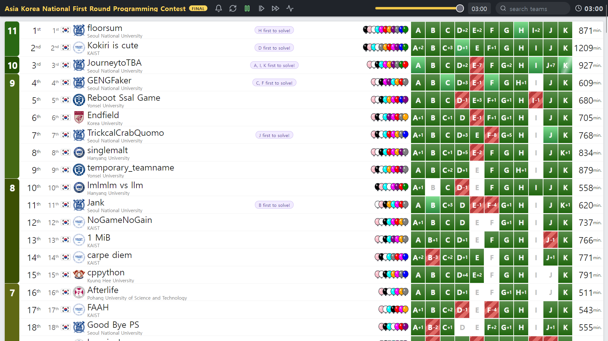

이미 다른 후기에서 몇 번 썼지만, 올해 ICPC 팀명은 Kokiri is cute이고, 팀원은 아래와 같습니다.

- `azberjibiou`: 현재 팀의 중심입니다. 쉬운 문제에서 기복이 적고, 쉬운 문제로 인식하는 범위가 넓습니다. 또한 어려운 문제를 붙잡고 풀어내는 것도 잘합니다. 즉, 만능입니다.
- `onjo0127`: ICPC WF와 IOI 경력을 모두 갖고 있습니다. 제가 알기로 올해 KAIST에서는 유일합니다. 아는 게 많고 비빔밥을 잘 비빕니다.
- `octane`: 나머지 2명에 비해 잘하는 건 기하 정도가 있습니다. 그래도 다른 문제들에서도 기본은 합니다.

## 타임라인

### 0:14

문제지가 도착하지 않았고 프린터에 문제가 있어 초반 30분 정도간 3명이서 화면을 3분할해서 읽었습니다. 우선 한글 문제부터 찾았고 `azberjibiou`가 G를 구현해 AC를 받았습니다. 여러 구현 방법이 있겠으나 DP를 사용했습니다. 그동안 `octane`이 스코어보드에서 잔뜩 풀리는 K를 읽고 queue에 넣었고 `onjo0127`은 한글 문제인 A를 queue에 넣었습니다.

### 0:17

`octane`이 K를 구현해 AC를 받았습니다.

### 0:48

`onjo0127`이 A 구현을 시작했습니다. 그러나 생각보다 오래 걸렸고, 풀이가 한 번 터져 `pbds`까지 동원했지만 TLE를 받았습니다. 그 사이에 `octane`이 H를 queue에 넣었고, `onjo0127`이 아예 새로 코드를 갈아엎겠다 선언한 사이 `octane`이 H에서 AC를 받았습니다. `azberjibiou`는 D를 읽고 그냥 구현하면 되는 문제라고 주장해 queue에 넣었습니다.

### 1:15

`azberjibiou`와 `onjo0127`이 D와 A를 번갈아 잡았습니다. `onjo0127`이 먼저 A에서 AC를 받았습니다.

### 1:21

`azberjibiou`가 D에서 AC를 받았습니다. 그 전에 `set`을 마구 쓰다가 TLE를 한 번 받았다고 합니다.

### 1:39

`azberjibiou`와 `onjo0127`이 머신을 잡는 동안 `octane`은 B, C, I를 queue에 넣은 상태였습니다. 혼자 3문제를 처리하려다가 말리면 큰일이기에, `azberjibiou`가 D를 짜는 동안 `onjo0127`에게 I 풀이를 설명했습니다. N이 500000인데 레이지세그 + 이분탐색으로 로그제곱 풀이를 낸 게 조금 걱정됐는데, `onjo0127`이 섹분탐색으로 로그를 뗄 수 있다고 주장해 마음 편하게 구현을 넘겼습니다. 이후 `octane`이 B를 구현해 AC를 받았습니다.

### 1:45

`octane`이 이어서 C를 구현하려 했으나 `azberjibiou`가 J를 읽고 그냥 골드라고 주장하면서 머신을 잡았습니다. 실제로 빠르게 AC를 받았습니다. 그동안 `octane`과 `onjo0127`이 F 풀이를 논의해 queue에 넣었습니다. 대충 KMP가 아닐 수 없는 문제였는데, 어떤 위치의 실패함수가 필요하다는 것은 그 위치까지 같았다는 뜻임을 이용해 잘 짜면 되는 문제였습니다.

### 2:12

`octane`이 C를 구현했습니다. 그러나 의문의 WA를 자꾸 받아 패널티를 3번이나 쌓았습니다. 그래서 프린트를 요청하고 `azberjibiou`가 F를 구현하기 시작했는데, 프린트 코드가 도착하기 전에 버그를 잡아 C에서 AC를 받았습니다.

### 2:32

`azberjibiou`가 F를 제출했으나 WA를 받았습니다. 일단 시간이 부족해 `onjo0127`이 I 구현을 시작했지만, 곧 `azberjibiou`가 반례를 찾아 F를 고쳐 AC를 받았습니다.

### 2:50

남은 문제는 E, I였고 `onjo0127`이 I 구현을 시작한 상태였습니다. 그런데 `azberjibiou`가 E가 그냥 예전에 본 게임이론 문제들처럼 하면 슥삭 풀릴 것 같다고 주장했습니다. 일단 종이에 구현을 한 상태로 queue에 넣었고, `onjo0127`이 I를 다 짜고 예제가 나오지 않아 디버깅을 할 때 `azberjibiou`가 잠깐 머신을 잡고 구현해서 제출했습니다. 그리고 AC를 받았습니다.

### 2:56

`onjo0127`이 I에서 AC를 받았습니다. AC가 뜨는 순간 `azberjibiou`와 함께 어흥어흥 세리머니를 했습니다.

## 후기

11솔브, 1209 패널티로 2등을 했습니다. 초반에 말린 것치고 좋은 성적을 거둬 며칠간 상당히 신이 났습니다. `azberjibiou`가 D, E, J 등 다른 팀이 헤맨 문제를 쉽게 풀어줬고 `onjo0127`은 A에서 말렸던 것을 속죄하듯 I에서 빠르게 한 번에 AC를 받아줬습니다. `octane`도 초반에 조금 말렸을 때 queue에 풀이들을 쌓았기 때문에 이번에는 1인분은 한 것 같습니다.

뭔가 다른 대회들에서도 Kokiri is cute가 최종 등수에 비해 초중반 등수가 낮았던 것 같습니다. 일단 후반에 등수가 잘 오르는 것은 팀원 3명이 잘 푸는 어려운 문제의 스타일이 다르기 때문이라고 봅니다. `azberjibiou`가 보통 후반까지 선형적으로 솔브 수를 늘려주는데, flow와 문자열까지도 잘하기 때문에 그게 안 되는 상황은 비빔밥 또는 기하 정도가 남습니다. 그걸 `onjo0127`과 `octane`이 처리해주면 됩니다. 따라서 초반에 한 번씩 말리는 것만 잘 해결해보면 좋을 것 같습니다.

## 다른 팀 염탐하기

제가 블루\~퍼플 주제에 1년째 경쟁자라고 주장하는 오렌지\~레드인 `annyeong1`의 블로그를 보고 아이디어를 얻은 섹션입니다. 제가 정보를 아는 팀의 리스트입니다.

- floorsum: 초 강팀입니다. 작년에도 비슷한 구성으로 최상급 ICPC 리저널 퍼포를 보인 것으로 알고 있으며 개인적으로도 친분이 있는, 즉 실력을 잘 알고 있는 멤버들이라 정말 두렵습니다.
- JourneytoTBA: 작년 서울대 3등 팀에 `jjang36524`가 치환되어 들어간 팀으로 알고 있습니다. 여기도 3명 다 어느 정도 아는 고수들입니다.
- Reboot Ssal Game: 작년에 각각 다른 팀에 속했던 멤버들이 팀명을 조금씩 떼온 팀입니다. `annyeong1`이 있기 때문에 늘 경쟁팀으로 생각하고 있습니다. 개인적으로 ICPC는 지금 얼마나 열심히 하는지가 상당히 중요하다고 생각하는데, 그런 측면에서 가장 견제되는 팀입니다.
- TrickcalCrabQuomo: 작년 서울대 4등 팀에 `terrasphere`가 치환되어 들어간 팀으로 알고 있습니다. 여기도 멤버들이 고수인 것으로 알고 있고 `terrasphere`가 자꾸 이상한 계정을 파서 실력에 비해 unknown인지라 이번이 큰 걸 터트릴 타이밍일 수도 있다고 생각합니다.
- singlemalt: 작년 한양대 월파 팀에 `hibye1217`님이 치환되어 들어간 팀으로 알고 있습니다. `gmroh06`님을 지난 런 가을대회에서 출제자로 처음 뵌 것 같은데, 문제가 인상 깊어 이후로 쭉 호감인 팀입니다.
- temporary_teamname: 연세대 팀으로 알고 있습니다. Reboot Ssal Game과 함께 되게 열심히 하는 팀이고, 온사이트 대회에서도 꽤 본 것 같아 기대됩니다.
- 1 MiB: 런방에서 자주 보는 두 팀 중 하나입니다. `parkky`, `mon_de2738`, `flakepowders`로 이루어져 있습니다. `parkky`는 늘 저보다 조금씩 잘하고, `flakepowders`는 SUAPC에서 D를 풀어내는 등 26학번인데 초 고능합니다. `mon_de2738`은 무려 APAC 메달리스트입니다. 이번에도 낮은 등수는 아니지만, 개인적으로는 더 높은 등수도 가능한 팀으로 생각합니다.
- cppython: 아마 SW-IT con에서 만난 경희대 팀 같습니다. 여기도 일단 대전까지 대회를 치러 온다는 점에서 악귀력이 상당하고, 멤버들도 고수로 알고 있습니다.
- FAAH: KAIST의 외국인 팀입니다. IOI, IOI, ICPC WF로 3명이 모두 국제전 경험이 있는 것으로 알고 있습니다. 그래서 상당히 견제했는데 예선에서는 그만큼의 퍼포먼스는 보여주지 못한 것 같습니다.
- 012: `azberjibiou`의 옛 팀원들이 있는 팀이라고 합니다.
- cutie et al: `ecubic`네 팀입니다. 프리즈 전까지 KAIST 내부 등수가 꽤 높았던 것으로 기억합니다. `ecubic`이 요즘 상당히 악귀이고, 저보다 이런저런 폼이 좋은 것 같아 본선이 기대됩니다. 아마 작년 제 팀원 `cywohoy`도 있는 것으로 알고 있습니다.
- fish3: 한국인과 외국인이 섞인 KAIST 팀입니다. KOI 금상과 선발고사 n등의 경기과학고 출신 26학번들이 있는 것으로 알고 있습니다.
- LCAaww: `abra_stone`, `loreips3115`, `cenix820`으로 구성된, 런방에서 자주 보는 두 팀 중 나머지 하나입니다. 개인적으로 아주 고평가하는 팀입니다. 예선 등수는 낮지만 E, F를 풀었기에 5시간 대회였다면 10솔\~11솔을 노릴 만도 했다고 봅니다. 참고로 3시간 동안 E, F를 모두 푼 팀은 floorsum, Kokiri is cute, Reboot Ssal Game, LCAaww뿐입니다. 작년에 제가 모든 플래를 풀고 `abra_stone`을 믿는 전략 + 베트남 침공으로 아챔에 갔는데, `loreips3115`는 저보다 플래를 잘 풀고 `loreips3115`, `cenix820`은 저보다 초반 퍼포가 높습니다. 또한 이 팀은 이번에 또 베트남 침공을 합니다.

