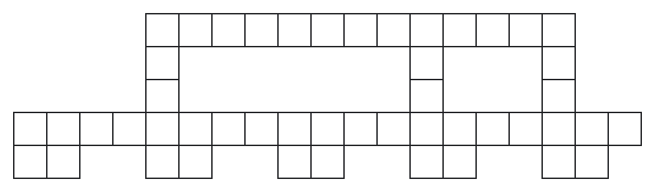
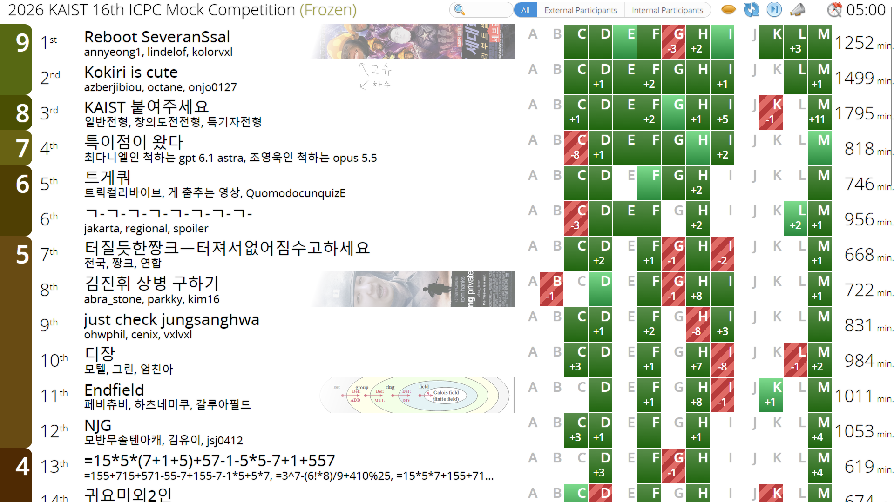

RUN 가을대회는 개인적으로 대학 대회들 중에 가장 좋아하는 대회이다. 작년부터 외부인 참가도 받아 꽤 스케일이 커졌는데, 올해는 아주 강한 팀원들이 있어 우승을 노리고 참가했다.

## 대회 전

`cenix820`에게 메이드복을 입히자는 의견은 반쯤 농담으로 꽤 오래전부터 나오고 있었다. 그런데 갑자기 `abra_stone`이 대회 3~4일쯤 전에 옷감을 주문하더니 말도 안 되는 집중력과 속도로 상당한 퀄리티의 메이드복을 만들어냈다. 사실 금요일에는 대학원 일 때문에 바빠서 런방에 가지 못했는데, 목요일에 본 것보다 대회 당일에 `cenix820`이 입고 온 메이드복의 퀄리티가 말도 안 되게 높아져 있어서 감탄했다. 아무도 직접 만들었다고 생각을 못 하는 것 같던데, 나는 정말 대회장 앞에서 `cenix820`을 만나자마자 눈을 믿을 수 없었다.

일단 이전부터 Reboot Ssal Game의 `JYJin`님이 `lindelof`님으로 치환되어 Reboot SeveranSsal으로 온다는 정보와 Just use CRT가 또 2명이서 온다는 사실을 알고 있었다. 그리고 대회 당일에 보니 서울대의 트게쿼 팀과 초 강력 고등학생들인 양승민, 김유담, 정우현 님이 와 계셨다. 그리고 센트로이드컵에서 내가 탈탈 털린 디미고의 초강팀 디쟝, 요즘 휴학으로 안 보이던 `mjhmjh1104` 등도 보이길래 예상은 했지만 정말 강팀이 많다고 느꼈다. 또한 `abra_stone`, `parkky`, `gs20036`으로 HeyJinhwi 팀에서 나 대신 `parkky`가 들어간 구성이 된 김진휘 상병 구하기 팀도 개인적으로 셋 다 고평가하고 좋아하는 사람들이라 잘할 것이라고 생각했다. 참고로 `gs20036`은 대회 다음 날 병장이 되었다고 한다.

이번 런 대회에는 후원 보상으로 스코어보드에 배경을 넣을 수 있는 기능이 있었다. `azberjibiou`가 이를 보자마자 보통 디스코드에서 `:left_upper_arrow:`를 다는 감성과 비슷하게 고슈 하슈 배경을 제안했다. 참고로 처음 배경 넣기 기능이 제공되었을 때는 배경을 넣으면 남들도 확인할 수 있길래, 스포일러를 최소화하기 위해 빼두었다가 대회가 시작하기 직전에 이를 기억해 배경이 이미 본대회 스코어보드에 반영된 걸 잠깐 풀어달라고 하고 시작 5분 전에 배경을 넣었다.

## 타임라인

### 00:19

`azberjibiou`가 A부터, 내가 E부터, `onjo0127`이 I부터 문제를 읽었다. 대놓고 쉬운 문제가 없어서인지 초반에 꽤 오래 스코어보드가 멈춰 있었다. 일단 E는 랜덤에 의존한 전략을 짜서 기댓값을 구하는 문제라 아주 쉽거나 꽤나 어렵거나 중 하나였고, 후자인 것 같길래 조금 보다가 F로 넘어갔다. 그런데 F가 그냥 시키는 걸 짜면 조화수열의 합이 $\log$ 정도라는 것 때문에 시간 복잡도가 최적화되는 문제였다. 그래서 그대로 짜고 WA를 받았다.

### 00:20

문제가 좀 더럽게 쓰여 있었는데, 이 때문에 등호를 하나 빼먹었다는 걸 확인하고 고쳐서 WA를 받았다.

### 00:34

`azberjibiou`가 나를 머신에서 쫓아내고 `onjo0127`이 M을 짜기 시작했다. 그러다가 내가 문제의 입력이 2차원 배열을 하나는 0-index, 하나는 1-index로 준다는 걸 발견하고 이번에는 진짜로 고쳐서 AC를 받았다. 끝나고 뒤풀이에서 출제자인 `mon_de2738`에게 물어보니 뭔가 문제가 급하게 수정되어 나오느라 본인도 그러고 싶지 않았는데 어쩔 수 없었다는 말을 했다. 그래서인지 풀이 설명 때도 문제에 대해 부끄러워하는 느낌으로 장난스럽게 넘어갔는데, 개인적으로는 풀이 세션이 전반적으로 그런 분위기가 아니었어서 어차피 쉬운 문제이니 짧게라도 진지하게 설명하고 넘어갔으면 좋았겠다고 느꼈다.

### 00:42

M에서 WA가 나왔다. 잘은 기억나지 않지만 나는 이때 스코어보드에서 풀리는 다른 문제를 보고 있었던 것 같다.

### 00:51

`azberjibiou`가 H는 그냥 하면 된다고 주장했다. H를 구현하는 중 `onjo0127`이 M을 고쳤고 AC가 나왔던 것 같다. 나는 사실 H와 M 둘 다 관심을 가지지 않고 있어서 잘 기억이 나지 않는다.

### 00:55

`azberjibiou`가 H에서 AC를 받았다.

### 01:33

D에서 솔브가 나오길래 내가 D를 꽤 오래 잡았다. 대충 방향성이 하나밖에 없는 인터랙티브 문제였다. 풀이의 방향성이 어느 정도 나왔을 때쯤 `azberjibiou`에게 풀이를 공유했는데, 일단 아주 복잡하지만 되기는 할 것 같아 내가 구현을 해보기로 했다. 대충 여러 layer에 대한 정보를 얻는 쿼리를 병렬적으로 동시에 담아서 처리하는 느낌이라 구현이 두려웠다. 그런데 키보드를 잡고 나니 너무나 구현이 하기 싫은 마음에 아주아주 간단한 풀이를 만들어버렸고, 말도 안 되게 짧은 코드를 당당히 제출해 TLE를 받았다.

### 01:51

풀이도 간결하고 코드도 짧아서 도저히 틀릴 곳이 없었다. 그래서 인터랙팅 자체에서 이슈가 생겨 아무 verdict나 받았다는 가정으로 코드를 뜯어보았고 쿼리를 날릴 때 날리는 수의 개수부터 출력해야 한다는 사실을 깨달았다. 이를 고쳐서 AC를 받았다.

### 02:31

그동안 `azberjibiou`는 I 풀이를 완성해두었다. 투스텝 느낌의 인터랙티브였는데 상당히 빨리 construction이 나온 상태라 이를 구현하여 WA를 받았다.

### 02:40

`azberjibiou`가 I를 고쳐서 제출했다. 그런데 채점이 무한히 오래 걸렸다. 나중에 보니 `dadas08`의 작품이었고 claude가 터진 서버를 고쳐줬다고 들었다. 만약 이 제출이 틀렸다면 억울하게 시간 패널티를 잔뜩 쌓을 뻔했지만 나중에 보니 AC였다.

### 03:12

`azberjibiou`가 한참 전에 G는 `onjo0127`이 풀어줘야 한다고 주장하고 넘겼었고, `onjo0127`이 드디어 인터랙티브의 늪에서 벗어난 머신을 잡더니 AC를 받았다.

### 04:10

이후에는 스코어보드에서 풀린 문제의 합집합은 작지 않지만 남은 문제들이 전부 조금씩만 풀린 상태였다. C, E, K, L을 전부 봐야 하는 상태였고, 내 인상으로 C는 `azberjibiou`가 잔뜩 케이스워크를 해뒀고 곧 풀 수 있다고 주장했지만 내가 그 케이스워크를 따라갈 이유는 없는 문제, E는 사소한 관찰 몇 개는 되지만 시간 내에 도는 풀이가 안 나오는 상태, K는 관상부터 무시무시해서 고민하고 싶지 않은 문제, L은 꽤 오래 고민을 하고 있었고 뭔가 풀 수도 있을 것 같은 상태였다. 그래서 나는 L을 잡고 `azberjibiou`와 `onjo0127`은 C와 E를 돌려가며 잡았다. 나중에 안 사실이지만 내 E 풀이에다가 NTT를 넣으면 문제가 풀린다고 한다. 그래도 내가 E를 넘길 때 맨 앞부터 시행을 박아도 될 것이라는 관찰을 함께 넘겼고, `azberjibiou`와 `onjo0127`은 각각 이것이 틀렸다 / 맞다로 나뉘었지만 맞다는 가정하에 나오는 제곱 풀이에서 예제가 나오는 것을 보고 NTT를 박아 AC를 받아냈다고 한다.

### 04:13

C에서도 진전이 있었다. `onjo0127`이 `azberjibiou`의 케이스워크를 좀 보더니 그냥 DP로 잘 풀릴 것이라는 주장을 했고, 실제로 AC를 받았다. E와 C의 AC 시간이 비슷한 것으로 보아 막히면 머신을 넘기는 식으로 진행한 것 같다. 나는 L과 함께 무한히 멘헤라에 걸려 있었다.

### 04:53

`azberjibiou`와 `onjo0127`은 이후 함께 K를 보고서는 보기보다 쉬운 문제라고 주장하며 풀이를 내버렸다. 그래서 `onjo0127`이 구현에 들어간 동안 내가 `azberjibiou`에게 지금까지 한 시도들을 알려주었다. L의 문제는 대충 아래와 같다.

> $X$가 주어지면 $10 \times 200$ 안에 들어가는 모양을 제시하여 이를 $1 \times 2$로 채우는 경우의 수가 $X$가 되게 하여라.

사실 `onjo0127`, `azberjibiou`와 이전에도 각각 조금씩 논의를 한 상태였다. 일단 우리가 핸들링 가능하게 경우의 수를 키우는 방법은 $2 \times n$으로 피보나치 수를 만드는 방법이 있고, $X$가 $10^{18}$까지 가능하기에 소수가 주어져버리면 곱셈만으로는 답을 만들 수 없다는 점 등을 쉽게 관찰했다. 그래서 수를 피보나치 수의 합으로 나타내는 제켄도르프 분할 등의 이야기가 나왔고, 실제로 $2 \times n$ 꼴의 모양들을 파이프로 잘 연결해 덧셈을 구현할 수 있는 방법까지는 내가 만들었다. 하지만 이를 주어진 공간에 넣는 것이 살짝 무리였다. 그래서 `azberjibiou`와 `onjo0127`이 다른 문제들을 미는 동안 내가 시도한 방법은 주어진 모양에 붙여서 경우의 수를 $+1$, $\times 2$ 등을 할 수 있게 만드는 가젯을 찾는 일이었다. 다른 팀의 후기와 에디토리얼의 풀이를 보니 이런 느낌으로도 풀 수 있는 것 같지만 나는 실패했다. 그러다가 `azberjibiou`가 그냥 특정 위치를 끊어서 앞은 $2^i$, 뒤는 $1$이 되게 하는 느낌이 가능하면 그냥 이진법으로 풀 수 있다는 아이디어를 냈고, 이를 듣자마자 아래 구성을 만들었다.

예를 들어 위 그림은 $26 = 2^4 + 2^3 + 2^1$에 대한 답이다. 위 세 줄이 내가 파이프라고 표현한 형태로, 잘 보면 정확히 한 곳만 네 번째 줄을 한 칸 침범하게 된다. 그러면 침범된 위치에 따라 왼쪽의 $2 \times 2$들은 자유로워지고 오른쪽은 타일링이 결정된다. 아무튼 `azberjibiou`가 당장 짤 수 있는 형태로 구현을 정리한 다음 `onjo0127`이 K를 구현하다가 막히는 순간에 구현해서 제출했고, AC를 받았다.

### 05:00

`onjo0127`이 K의 예제가 나오게 하려고 노력했지만 시간이 종료되었다. 듣기로는 대회 종료 후 10분쯤 뒤에 예제가 나왔다고 한다.

## 후기

프리즈 당시 순위가 최상위권은 아니었지만, 프리즈 이후 3솔을 했고 다른 팀은 그렇게 많은 문제를 제출하지 않았었다. 이에 따라 계산했을 때 Reboot Ssal Game이 K를 풀었다면 2등, K를 풀지 못했다면 1등이라는 사실을 알았다. 마지막까지 `kolorvxl`님이 키보드를 잡는 걸 봤기에 내심 기대했으나 그건 G였다고 한다.

대회가 끝난 당일에는 내가 거의 2시간 동안 L에 꼴아박았는데도 `azberjibiou`와 `onjo0127`이 어려운 문제들을 계속 풀어준 것 때문에 내가 조금 더 잘했더라면 하는 정병이 왔는데, 다른 팀의 후기글을 읽어보고 지금 스코어보드를 다시 보니 그냥 셋 자체가 끝까지 뭔가 짜다가 아쉽게 끝나는 셋 같았고, L을 푼 것도 유의미한 기여 같아서 조금 내려놓기로 했다. 나름 이번 대회에 참가한 현역 ICPC 팀만 보면 꽤나 높은 성적 같아서 만족한다.

또한 이번 대회는 PS로 상금을 받는 첫 대회이기도 하다. 올해 강하고 열정적인 팀원들을 만나서 참 감사하고 나도 이 기회를 놓치지 않도록 더욱 열심히 해야겠다는 생각이 들었다.
